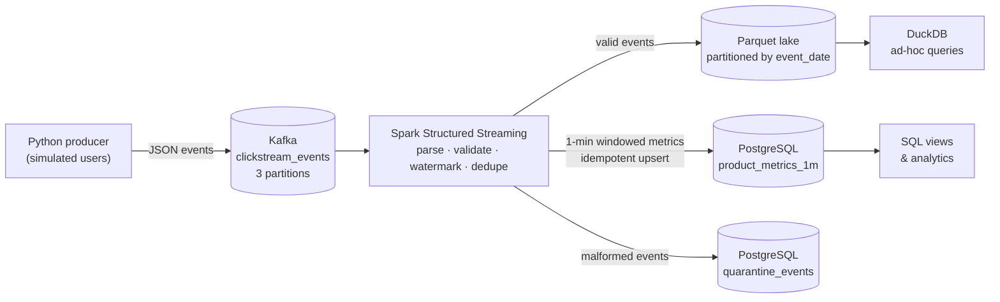

# Real-Time E-Commerce Clickstream Pipeline

A streaming data pipeline that ingests e-commerce clickstream events through **Apache Kafka**, processes them with **PySpark Structured Streaming**, and lands them in two places: a **Parquet data lake** for raw history and **PostgreSQL** for live funnel metrics. Bad records are not dropped silently: they go to a quarantine table.

The whole stack runs locally with one command using **Docker Compose**, and every component is free and open source.



## What it does

The producer simulates a few hundred concurrent shoppers. Each session moves through a realistic funnel (page view → add to cart → purchase) across 14 products in 5 categories. To make the pipeline prove itself, the producer also injects the kinds of dirty data real systems see:

| Injected problem | Share | How the pipeline handles it |
| --- | --- | --- |
| Late events (5–90 s behind) | 3% | Accepted: they fall inside the 2-minute watermark and land in the correct window |
| Very late events (10 min behind) | 0.2% | Dropped by the watermark, so finalized windows are never reopened |
| Duplicate events (same `event_id`) | 1% | Removed with `dropDuplicatesWithinWatermark` |
| Malformed events (broken JSON, missing fields, bad timestamps) | 0.5% | Routed to `quarantine_events` with an `error_reason` |

The Spark job runs **three streaming queries**, each with its own checkpoint:

1. **`events_lake`** writes cleaned, de-duplicated events to Parquet, partitioned by `event_date`.
2. **`product_metrics`** computes per-product funnel metrics (views, add-to-carts, purchases, units, revenue, unique users, conversion rate) in 1-minute tumbling event-time windows and upserts them into Postgres.
3. **`quarantine`** writes invalid records, with their Kafka partition and offset, to Postgres for inspection and replay.

## Tech stack

| Layer | Tool |
| --- | --- |
| Message broker | Apache Kafka 3.7 (KRaft mode, no ZooKeeper) |
| Stream processing | Apache Spark 3.5 Structured Streaming (PySpark), RocksDB state store |
| Serving database | PostgreSQL 16 |
| Data lake | Parquet files on local disk (S3-compatible layout) |
| Ad-hoc analytics | DuckDB |
| Producer | Python, `confluent-kafka` (idempotent producer) |
| Infrastructure | Docker, Docker Compose |
| Quality | pytest, ruff, GitHub Actions CI |

## Quick start

**Prerequisites:** Docker Desktop (or Docker Engine + Compose v2) with about 4 GB of memory available. Python 3.11+ is only needed for tests and the DuckDB script.

```bash
git clone https://github.com/diiyark123/realtime-clickstream-pipeline.git
cd realtime-clickstream-pipeline
cp .env.example .env          # optional: tweak event rate, watermark, window size
make up                       # or: docker compose up -d --build
```

The first start takes a few minutes while Spark downloads the Kafka connector. Follow progress with:

```bash
make logs
```

Metrics for a window appear once the watermark passes its end, so expect the first rows in Postgres about **3 minutes** after events start flowing.

## Guided demo and health check

```bash
make check        # one-screen health report of every stage
make demo         # send a test purchase (+ a duplicate and a broken copy) and follow it through every stage
```

`make demo` checks each stage and prints ✅/❌: the 3 messages land in Kafka, the broken one is quarantined, the good one is saved to the lake once (the duplicate is removed), and it is counted in the metrics table, whose totals are then recomputed from the lake to prove they match. It needs DuckDB on the host (`pip install duckdb`).

The Spark log prints one line per query per batch, including the current watermark and how many events were dropped as too late:

```
[product_metrics] batch=474 read=465 rows watermark=2026-10-19T16:11:20.014Z dropped_too_late=3
```

## Seeing the results

```bash
make topic        # peek at raw JSON messages on the Kafka topic
make metrics      # revenue and purchases per minute
make quarantine   # count of bad records by reason
make psql         # interactive SQL shell; then: \i /sql/analytics.sql
make lake         # query the Parquet lake with DuckDB (pip install duckdb first)
```

The Spark UI is at <http://localhost:4040>. Its **Structured Streaming** tab shows input rate, processing rate, batch duration and state size for each query.

Illustrative output of `make quarantine` (your counts will differ):

```
     error_reason      | count
-----------------------+-------
 unparseable_json      |    41
 missing:event_id      |    16
 invalid_event_ts      |    13
 ...
```

`sql/analytics.sql` also includes a top-products query, a category funnel and a **freshness check** (`now() - max(window_end)`) that tells you how far behind real time the metrics are.

## Design decisions

**Event time, not processing time.** Windows are based on `event_ts` from the event itself, so a late event is counted in the minute it actually happened, not the minute it arrived.

**Watermark of 2 minutes.** This is the trade-off between completeness and latency. Events up to 2 minutes late are counted; older ones are dropped so Spark can finalize windows and free state. Change it with `WATERMARK_DELAY`.

**Append output mode for metrics.** Each window is written once, after the watermark passes, so every row in Postgres is final. The cost is about 3 minutes of latency. Update mode would show numbers sooner but they would keep changing, and Spark doesn't allow update mode with two chained stateful operators (dedup + aggregation).

**Idempotent writes.** If Spark restarts and replays a batch from its checkpoint, the metrics `INSERT ... ON CONFLICT DO UPDATE` and the quarantine `ON CONFLICT (partition, offset) DO NOTHING` produce the same result. Combined with Kafka offsets tracked in checkpoints, this gives effectively-exactly-once results in Postgres.

**Quarantine instead of drop.** Bad records keep their raw payload and Kafka coordinates, so they can be debugged, counted as a data-quality metric, and replayed after a fix.

**RocksDB state store.** Keeps dedup and aggregation state off the JVM heap, which is the recommended setting for long-running stateful streams.

**Partitioned lake.** Partitioning Parquet by `event_date` lets queries skip whole days, the same layout you'd use on S3 with Athena, Trino or Spark.

## Project structure

```
.
├── docker-compose.yml        # Kafka, topic init, Postgres, producer, Spark
├── Makefile                  # common commands
├── .env.example              # tunable settings
├── producer/
│   ├── event_generator.py    # session simulation + dirty-data injection (no dependencies)
│   ├── producer.py           # Kafka producer loop
│   └── Dockerfile
├── spark/
│   ├── transforms.py         # parsing, validation, dedup, windowed metrics (pure functions)
│   ├── streaming_job.py      # readStream, sinks, foreachBatch upserts
│   └── Dockerfile
├── sql/
│   ├── init.sql              # tables, indexes, views
│   └── analytics.sql         # example queries
├── scripts/
│   ├── inspect_lake.py       # DuckDB over the Parquet lake
│   ├── check_pipeline.sh     # make check
│   └── demo_flow.sh          # make demo
├── tests/                    # pytest: generator + Spark transforms
├── docs/                     # technical doc, user manual, beginner's guide (Word)
└── .github/workflows/ci.yml  # lint + tests on every push
```

## Running tests

```bash
python -m venv .venv && source .venv/bin/activate
pip install -r requirements-dev.txt
make test         # needs Java 17 for the Spark tests
make lint
```

The Spark tests run the same `transforms.py` functions on static DataFrames, so the logic is tested without Kafka. If PySpark isn't installed they are skipped and the generator tests still run.

Use Python 3.11 or 3.12: the pinned `confluent-kafka` and `psycopg2-binary` versions have no Python 3.13 wheels. On 3.13, install only what the tests need: `pip install pytest pyspark==3.5.1 ruff duckdb`.

## Configuration

| Variable | Default | Purpose |
| --- | --- | --- |
| `EVENTS_PER_SECOND` | 50 | Producer throughput |
| `WATERMARK_DELAY` | 2 minutes | How late an event may be and still count |
| `METRICS_WINDOW` | 1 minute | Tumbling window size |
| `TRIGGER_INTERVAL` | 10 seconds | Micro-batch interval |
| `MAX_OFFSETS_PER_TRIGGER` | 20000 | Back-pressure cap per batch |

## Troubleshooting

- **Spark container restarting:** run `docker compose logs spark`. On first run it needs internet access to download the Kafka connector from Maven Central.
- **No rows in `product_metrics_1m`:** wait for the watermark (about 3 minutes). Check the Spark UI to confirm input is arriving.
- **Port already in use:** 9092, 5432 and 4040 must be free, or change the host ports in `docker-compose.yml`.
- **Start fresh:** `make reset` removes volumes, checkpoints and the lake.
- **`docker: command not found` on macOS:** add Docker Desktop's CLI to your PATH: `export PATH="/Applications/Docker.app/Contents/Resources/bin:$PATH"`.

## Possible extensions

- Swap the local lake for MinIO (S3-compatible) and write Delta Lake or Apache Iceberg tables.
- Add a Schema Registry and Avro to enforce event contracts at the producer.
- Add a Grafana dashboard over the Postgres views.
- Session-level metrics with `session_window` (session length, events per session).

## License

MIT
